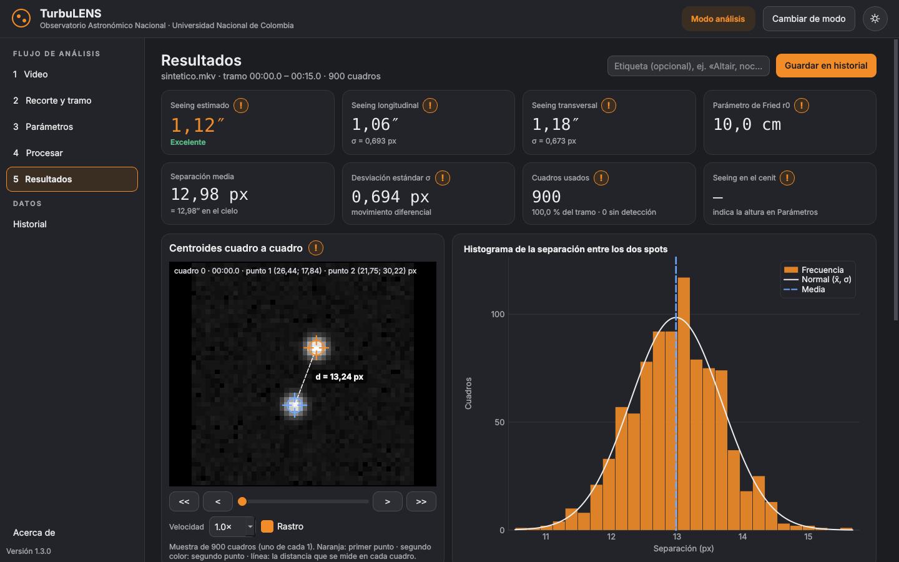
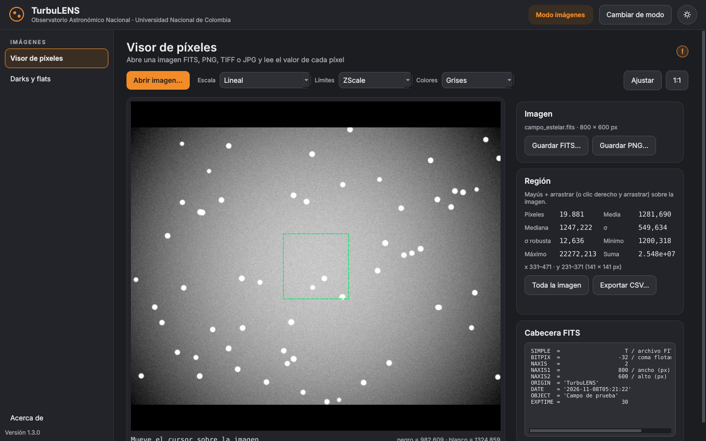
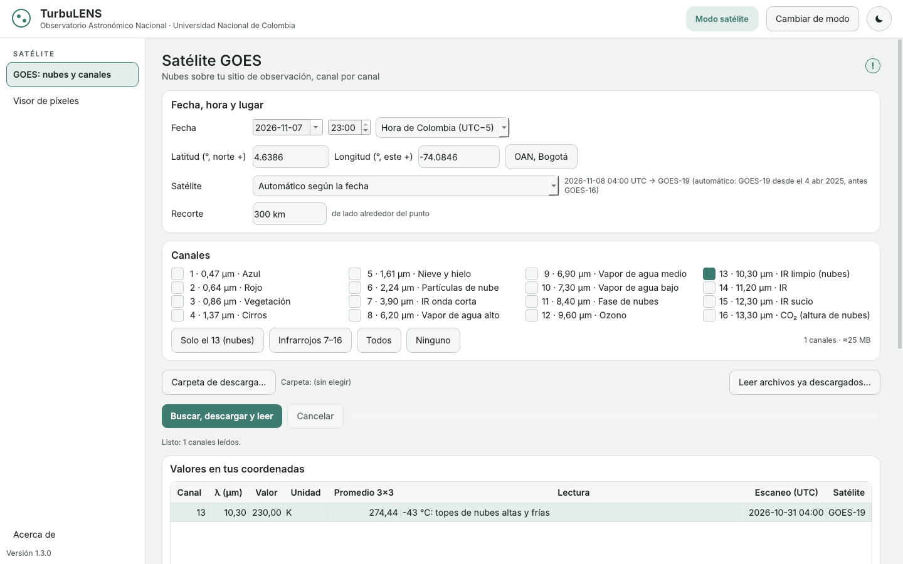
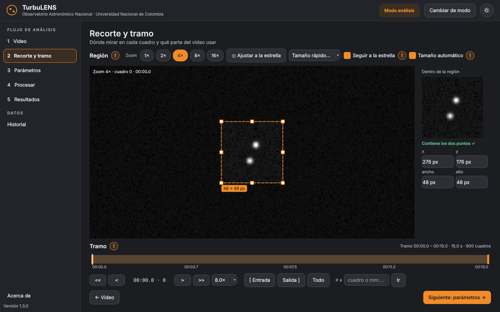
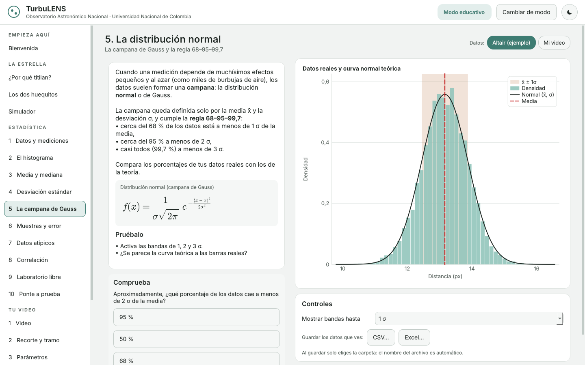

<p align="center"></p>

<h1 align="center">TurbuLENS</h1>

<p align="center"><b>Separa videos de un DIMM en imágenes, mide el seeing de tu cielo y aprende estadística con una estrella.</b><br>
Observatorio Astronómico Nacional · Universidad Nacional de Colombia</p>

<p align="center"></p>

## Descarga

**Versión actual: 1.3.0.** Descarga el archivo de tu sistema, descomprímelo y abre TurbuLENS: **no hay que instalar Python ni nada más**. Funciona en **español, inglés y portugués**.

| Sistema | Descarga directa | Se abre con |
|---|---|---|
| Windows 10/11 | [TurbuLENS-v1.3.0-Windows-x64.zip](https://github.com/DiegoCagua/TurbuLENS/releases/download/v1.3.0/TurbuLENS-v1.3.0-Windows-x64.zip) | `TurbuLENS.exe` |
| Mac con Apple Silicon | [TurbuLENS-v1.3.0-macOS-AppleSilicon.zip](https://github.com/DiegoCagua/TurbuLENS/releases/download/v1.3.0/TurbuLENS-v1.3.0-macOS-AppleSilicon.zip) | `TurbuLENS.app` |
| Mac con Intel | [TurbuLENS-v1.3.0-macOS-Intel.zip](https://github.com/DiegoCagua/TurbuLENS/releases/download/v1.3.0/TurbuLENS-v1.3.0-macOS-Intel.zip) | `TurbuLENS.app` |
| Linux | [TurbuLENS-v1.3.0-Linux-x64.tar.gz](https://github.com/DiegoCagua/TurbuLENS/releases/download/v1.3.0/TurbuLENS-v1.3.0-Linux-x64.tar.gz) | `TurbuLENS` |

Las notas de cada versión y las versiones anteriores están en **[Releases](https://github.com/DiegoCagua/TurbuLENS/releases)**.

> La primera vez, Windows puede mostrar «Windows protegió su PC»: pulsa *Más información → Ejecutar de todas formas*. En Mac, abre la app con clic derecho → *Abrir*.

## Qué hace

**Modo análisis** (mediciones científicas)

1. **Video**: abre cientos de formatos (MOV, MP4, AVI, MKV, WMV, MTS, WebM, SER, FITS, …) con FFmpeg incluido, también de cámaras astronómicas de 16 bits. Arrastra el archivo a la ventana o búscalo.
2. **Recorte y tramo**: dibuja la región de la estrella **como en Paint** (arrastrar, mover, cuadritos para cambiar el tamaño, zoom con la rueda) o pulsa *Ajustar a la estrella*. Elige el tramo con una línea de tiempo: `<<` `>>` reproducen a velocidad constante (0.25× a 32× respecto al video real; la región sigue a la estrella en vivo), `<` `>` mueven un cuadro, `[ Entrada` y `Salida ]` marcan el tramo, *Ir a* salta a un cuadro o a un minuto.
3. **Parámetros**: diámetro y separación de los orificios, longitud de onda (con unidades a elegir: µm, mm o cm), escala de placa (con calculadora, lista de cámaras y enlaces para consultarla), altura de la estrella (con decimales, explicada en su botón **!**), calibración opcional con **dark y flat**, y perfiles de equipo que se pueden guardar, actualizar, renombrar y eliminar, compartidos por los dos modos. Si cambias estos valores después de procesar, el seeing se recalcula al instante, sin volver a procesar.
4. **Procesar**: no empieza sin escala de placa (lo avisa). Separa el video en imágenes recortadas y **seguidas** (la región encuentra a la estrella aunque haya quedado lejos, se recentra en cada cuadro y ajusta su tamaño al de los spots), en PNG (predeterminado, el más eficiente), TIFF 16 bits, JPG, un cubo NumPy o un cubo FITS. Mide los dos puntos en cada cuadro.
5. **Resultados**: seeing (longitudinal, transversal y promedio), r₀, corrección al cenit, histograma con la curva normal, σ segundo a segundo (para detectar golpes o ráfagas), diagrama del movimiento diferencial y las **correlaciones r** que dicen si los datos se comportan como turbulencia (explicadas también en el informe PDF).
6. **Historial**: base de datos local para comparar noches y épocas del año, con etiquetas y notas; es el mismo en el modo análisis y en el educativo (una columna dice en cuál se hizo cada análisis).

**Exportación** desde Resultados y desde el Historial (solo eliges la carpeta; el nombre de los archivos es automático y nunca se sobrescribe nada): datos en **CSV, Excel, JSON, NumPy y tabla FITS**; gráficas en **PDF (solo gráficas), PNG y SVG**; e **informe PDF** completo. Además, cada procesamiento deja `mediciones.csv` y `resumen.json` junto a las imágenes.

> **Escala de placa con cámaras de fotos (Nikon, Canon) o celulares.** Al grabar video, la cámara reduce la imagen del sensor: el píxel que vale es el **efectivo**, ancho del sensor ÷ ancho del video (Nikon D5600: 23,5 mm ÷ 1920 px = 12,2 µm, no los 3,9 µm del sensor). Con el píxel del sensor la escala sale unas 3 veces menor y el seeing, unas 3 veces mejor de lo real. La calculadora de *Parámetros* lo hace sola con la casilla *Grabé en video*. Las cámaras astronómicas (QHY, ZWO) usan los píxeles reales.

**Modo educativo** (colegios y cursos): el eje es **aprender estadística** con datos reales de una estrella.

| Lección | Tema |
|---|---|
| 1 | Datos y mediciones: cada cuadro es un dato |
| 2 | El histograma: intervalos y frecuencias |
| 3 | Media y mediana: el valor típico y la robustez |
| 4 | Varianza y desviación estándar: σ mide la turbulencia |
| 5 | La distribución normal y la regla 68–95–99,7 |
| 6 | Muestras y error de la media (σ/√n, límite central) |
| 7 | Datos atípicos: un error real del programa original |
| 8 | Correlación entre dos variables |
| 9 | Laboratorio libre |
| 10 | Prueba final de 11 preguntas |

Cada lección tiene controles interactivos, tablas que cambian con los datos elegidos, fórmulas en LaTeX, una pregunta que se responde una sola vez por sesión (con las opciones en orden al azar), guarda sus datos en **CSV o Excel** y puede usar los datos de ejemplo (Altair) o **el video que procese la clase**. La parte astronómica va primero y se explica en tres pantallas muy sencillas con **animaciones** (por qué titilan las estrellas, el truco de los dos huequitos y un simulador). El historial y los perfiles de equipo son **los mismos** en los dos modos.

**Modo Imágenes**: crea maestros de **bias, dark y flat** (mediana, media o media con recorte de 3 σ), calibra tus imágenes del cielo con (luz − dark) ÷ flat normalizado y guarda todo en FITS de 32 bits. Su **visor de píxeles** funciona como SAOImage DS9: valor del píxel bajo el cursor, escalas lineal, logarítmica, raíz, asinh e histograma ecualizado, límites ZScale o por percentiles, mapas de color, zoom con la rueda, estadística de una región (media, mediana, σ, σ robusta, mínimo, máximo, suma), exportación de los píxeles de la región a CSV y la cabecera FITS. Los maestros se pueden usar directamente en el análisis de video.

**Modo Satélite**: para saber si había nubes cuando grabaste. Eliges fecha y hora (de Colombia o UTC), coordenadas (por defecto el OAN), los canales del ABI (1 a 16) y una carpeta; TurbuLENS busca la imagen de **disco completo** más cercana en el repositorio abierto de NOAA, usa **GOES-16** hasta el 4 de abril de 2025 y **GOES-19** desde entonces (o el que elijas), descarga los archivos, lee el valor en tu punto (reflectancia o temperatura de brillo, con una lectura sencilla: «nubes altas y frías», «probablemente despejado»…) y guarda un CSV y recortes en FITS y PNG que se pueden abrir en el visor.

<p align="center">


</p>

En **Resultados**, una **animación de los centroides** muestra cuadro a cuadro dónde ubicó TurbuLENS cada punto (cruces, distancia medida y rastro de las posiciones anteriores).

La ventana se abre maximizada (F11 para pantalla completa sin bordes, Esc para salir). Ambos modos tienen tema **claro y oscuro** (sol / luna), botones **!** que explican cada control al hacer clic y tres idiomas (**español, English, Português**, en *Acerca de* o en la pantalla de inicio). La reproducción usa en todas partes los mismos botones `<<` `<` `>` `>>` y las mismas velocidades (0.25× a 32× respecto al video real).

<p align="center">


</p>

## Cómo funciona

1. Cada cuadro se decodifica con **PyAV/FFmpeg** directamente a un arreglo de **NumPy** en escala de grises (8 o 16 bits), sin guardar el video completo en memoria.
2. Se recorta la región; si *Seguir a la estrella* está activo, la región se recentra con los últimos cuadros válidos y se vuelve a buscar la estrella si se pierde.
3. Los cuadros se procesan **en bloques vectorizados** `(n, alto, ancho)`: fondo por mediana y ruido por MAD; los píxeles con luz se separan en **dos grupos** (k-medias ponderado por intensidad, que empieza en el píxel más brillante y en el píxel con luz más lejano) y el centro de cada grupo es su **centroide**, recortado alrededor del spot (precisión de centésimas de píxel). Así funciona con spots pequeños, grandes, en anillo o partidos. Un cuadro solo cuenta si los dos spots están bien separados, tienen suficiente señal y hay una caída de luz entre ellos.
4. Las mediciones van a un **arreglo estructurado de NumPy reservado de antemano** (sin listas ni archivos intermedios).
5. Los vectores se orientan con el eje principal (los puntos pueden intercambiarse entre cuadros), se proyectan sobre la línea de base (longitudinal) y su perpendicular (transversal) y se descartan los atípicos a más de 5 σ robustas.
6. El seeing sale del modelo de **Tokovinin (2002)**: σ²ₗ,ₜ = Kₗ,ₜ λ² r₀^(−5/3) D^(−1/3), con Kₗ = 0,364 (1 − 0,532 b^(−1/3) − 0,024 b^(−7/3)), Kₜ = 0,364 (1 − 0,798 b^(−1/3) + 0,018 b^(−7/3)), b = B/D y ε = 0,98 λ/r₀.

Con el video de prueba de Altair (1920 × 1080, 59,94 cuadros/s, 8.484 cuadros) TurbuLENS mide los 8.484 cuadros en unos 12 s, guarda las 8.484 imágenes recortadas en unos 5 MB (el programa original generaba ~900 MB de JPG) y obtiene σ = 0,716 px. Con 1″/px, D = 2,5 cm y B = 14 cm eso da un seeing de 1,14″. Más detalles en [docs/metodo.md](docs/metodo.md) y en el [análisis de los códigos originales](docs/analisis_codigos_originales.md).

## Desde el código fuente

```bash
git clone https://github.com/DiegoCagua/TurbuLENS
cd TurbuLENS
pip install -r requirements.txt
python -m turbulens                      # abre la aplicación
python -m turbulens --autoprueba         # prueba sin ventana
python -m pytest                         # pruebas del motor
pyinstaller packaging/turbulens.spec     # ejecutable para tu sistema
```

Cada `git push` ejecuta las pruebas en GitHub Actions y compila y prueba los ejecutables de Windows, macOS y Linux. Cuando llega a `main` una versión nueva (`python scripts/nueva_version.py X.Y.Z`), se publica sola en *Releases* con los archivos de Windows, Mac y Linux.

Los textos de la interfaz están en español en el código; las traducciones están en `turbulens/locales/en.json` y `pt.json` (clave = texto en español).

```
turbulens/
  core/        motor sin interfaz: video, detección, DIMM, estadística, FITS, calibración, GOES, exportación, historial
  gui/         interfaz PySide6 (páginas de los cuatro modos, visor de imágenes, animaciones, temas, idiomas)
  _vendor/     pyfive (lector de NetCDF4/HDF5 en Python puro, BSD-3) para el modo Satélite
  locales/     traducciones al inglés y al portugués
  charts.py    gráficas dibujadas con Qt (pantalla, PNG, SVG, PDF)
  reports.py   gráficas e informes de un análisis o del historial
tests/         pruebas con videos sintéticos de valores conocidos
docs/          método, análisis de los códigos originales, capturas y diseños de la interfaz
packaging/     PyInstaller y notas de versión
```

## Diseño

El diseño de la interfaz partió de 10 borradores y tres versiones preliminares interactivas, guardados en [docs/diseno](docs/diseno).

## Créditos

**Autores:** Diego Fernando Cagua Lozada, Fredy Esteban Cruz Ospina y Saray Juliana Pinto Sanabria (coautora y pruebas), estudiantes del pregrado de Física, Departamento de Física, Universidad Nacional de Colombia, Bogotá D.C.

TurbuLENS se desarrolló para la asignatura **Técnicas Observacionales** de la Maestría en Astronomía del Observatorio Astronómico Nacional, Universidad Nacional de Colombia, Bogotá D.C.

Basado en el protocolo *Determina la nitidez del cielo nocturno en tu lugar de observación* (ANDEAN ROAD, Oficina Regional Andina de la Astronomía para el Desarrollo, 2026) y en A. Tokovinin, *From differential image motion to seeing*, PASP 114, 1156 (2002), [arXiv:astro-ph/0111022](https://arxiv.org/abs/astro-ph/0111022).

Construido con Python, NumPy, PySide6 (Qt), PyAV (FFmpeg), Pillow, openpyxl y pyfive. Las imágenes del modo Satélite son de NOAA (GOES-R Series, producto ABI L2 CMIPF, NOAA Open Data Dissemination).

## Cómo citar

Si usas TurbuLENS en un trabajo, informe, clase o publicación, da crédito a los autores:

> Cagua Lozada, D. F., Cruz Ospina, F. E., & Pinto Sanabria, S. J. (2026). *TurbuLENS* (versión 1.3.0) [Software]. Observatorio Astronómico Nacional, Universidad Nacional de Colombia. https://github.com/DiegoCagua/TurbuLENS

```bibtex
@software{cagua_lozada_turbulens_2026,
  author    = {Cagua Lozada, Diego Fernando and Cruz Ospina, Fredy Esteban and Pinto Sanabria, Saray Juliana},
  title     = {TurbuLENS: medición del seeing con un DIMM y enseñanza de la estadística},
  year      = {2026},
  version   = {1.3.0},
  publisher = {Observatorio Astronómico Nacional, Universidad Nacional de Colombia},
  url       = {https://github.com/DiegoCagua/TurbuLENS}
}
```

GitHub también ofrece el botón *Cite this repository* a partir de [`CITATION.cff`](CITATION.cff). La app muestra estas citas en *Acerca de*, con botones para copiarlas, y cada informe, gráfica o exportación lleva una línea de crédito.

## Licencia

TurbuLENS se distribuye bajo la licencia **[PolyForm Noncommercial 1.0.0](LICENSE)**:

- ✅ Puedes usarlo, estudiarlo, modificarlo y compartirlo para **fines no comerciales**: estudio personal, investigación, enseñanza, colegios, universidades, organizaciones sin ánimo de lucro y entidades públicas.
- ✅ Toda copia o versión modificada debe incluir la licencia y las líneas **`Required Notice`** que dan crédito a los autores.
- ❌ **No se permite el uso comercial** (venderlo, cobrar por usarlo o usarlo para obtener ganancias) sin permiso escrito de los autores.

Por no permitir el uso comercial, TurbuLENS es software de **código fuente disponible**, no «código abierto» en el sentido de la OSI. Las versiones hasta la 1.0.0 se publicaron con licencia MIT; desde la 1.1.0 rige PolyForm Noncommercial. Los componentes de terceros conservan sus licencias: ver [THIRD_PARTY_NOTICES.md](THIRD_PARTY_NOTICES.md).
