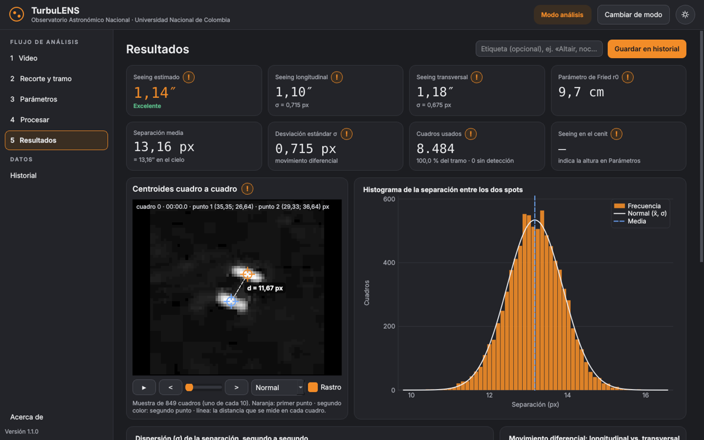
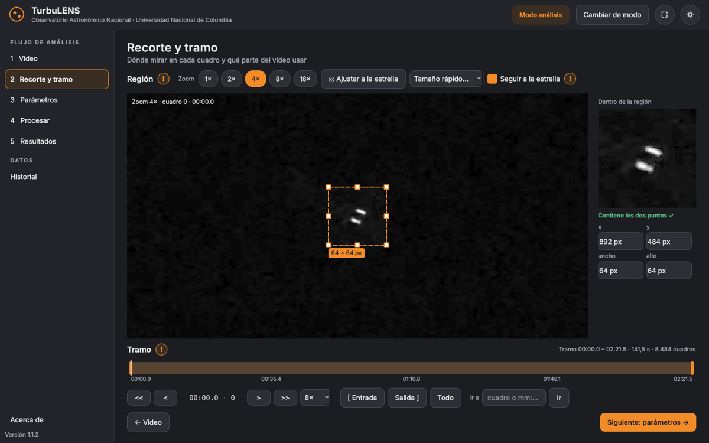
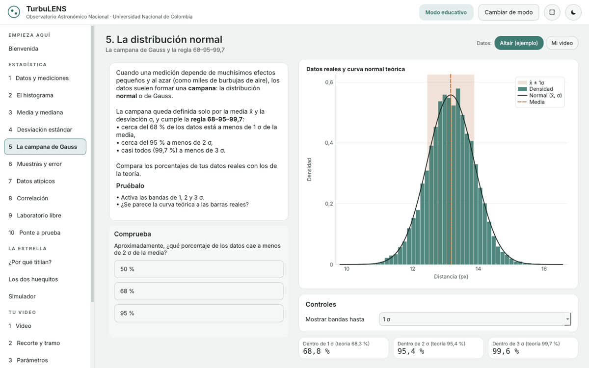

<p align="center"></p>

<h1 align="center">TurbuLENS</h1>

<p align="center"><b>Separa videos de un DIMM en imágenes, mide el seeing de tu cielo y aprende estadística con una estrella.</b><br>
Observatorio Astronómico Nacional · Universidad Nacional de Colombia</p>

<p align="center"></p>

## Descarga

Ve a **[Releases](https://github.com/DiegoCagua/TurbuLENS/releases/latest)** y baja el archivo de tu sistema. Descomprímelo y abre TurbuLENS: **no hay que instalar Python ni nada más**.

| Sistema | Archivo |
|---|---|
| Windows 10/11 | `TurbuLENS-v1.0.0-Windows-x64.zip` → `TurbuLENS.exe` |
| Mac con Apple Silicon | `TurbuLENS-v1.0.0-macOS-AppleSilicon.zip` → `TurbuLENS.app` |
| Mac con Intel | `TurbuLENS-v1.0.0-macOS-Intel.zip` → `TurbuLENS.app` |
| Linux | `TurbuLENS-v1.0.0-Linux-x64.tar.gz` → `TurbuLENS` |

> El programa no está firmado digitalmente. La primera vez, en Windows pulsa *Más información → Ejecutar de todas formas*; en Mac, clic derecho → *Abrir*.

## Qué hace

**Modo análisis** (mediciones científicas)

1. **Video**: abre cientos de formatos (MOV, MP4, AVI, MKV, WMV, MTS, WebM, SER, FITS, …) con FFmpeg incluido, también de cámaras astronómicas de 16 bits. Arrastra el archivo a la ventana o búscalo.
2. **Recorte y tramo**: dibuja la región de la estrella **como en Paint** (arrastrar, mover, cuadritos para cambiar el tamaño, zoom con la rueda) o pulsa *Ajustar a la estrella*. Elige el tramo con una línea de tiempo: `<<` `>>` reproducen a velocidad constante (2× a 32×), `<` `>` mueven un cuadro, `[ Entrada` y `Salida ]` marcan el tramo, *Ir a* salta a un cuadro o a un minuto.
3. **Parámetros**: diámetro y separación de los orificios, longitud de onda, escala de placa (con calculadora y enlaces para consultarla), altura de la estrella y perfiles de equipo guardados.
4. **Procesar**: separa el video en imágenes recortadas y **seguidas** (la región se recentra si la estrella se mueve), en PNG (predeterminado, el más eficiente), TIFF 16 bits, JPG, un cubo NumPy o un cubo FITS. Mide los dos puntos en cada cuadro.
5. **Resultados**: seeing (longitudinal, transversal y promedio), r₀, corrección al cenit, histograma con la curva normal, σ segundo a segundo (para detectar golpes o ráfagas) y diagrama del movimiento diferencial.
6. **Historial**: base de datos local para comparar noches y épocas del año, con etiquetas y notas.

**Exportación** desde Resultados y desde el Historial: datos en **CSV, Excel, JSON, NumPy y tabla FITS**; gráficas en **PDF (solo gráficas), PNG y SVG**; e **informe PDF** completo. Además, cada procesamiento deja `mediciones.csv` y `resumen.json` junto a las imágenes.

**Modo educativo** (colegios y cursos): el eje es **aprender estadística** con datos reales de una estrella.

| Lección | Tema |
|---|---|
| 1 | Datos y mediciones: cada cuadro es un dato |
| 2 | El histograma: intervalos y frecuencias |
| 3 | Media y mediana: el valor típico y la robustez |
| 4 | Varianza y desviación estándar: σ mide la turbulencia |
| 5 | La distribución normal y la regla 68–95–99,7 |
| 6 | Muestras y error de la media (σ/√n, límite central) |
| 7 | Datos atípicos: un error real del programa original |
| 8 | Correlación entre dos variables |
| 9 | Laboratorio libre |
| 10 | Prueba final de 11 preguntas |

Cada lección tiene controles interactivos, una explicación corta, una pregunta para comprobar y puede usar los datos de ejemplo (Altair) o **el video que procese la clase**. La parte astronómica se explica en tres pantallas muy sencillas (por qué titilan las estrellas, el truco de los dos huequitos y un simulador). Las mediciones del modo educativo se guardan **aparte** de las científicas.

En **Resultados**, una **animación de los centroides** muestra cuadro a cuadro dónde ubicó TurbuLENS cada punto (cruces, distancia medida y rastro de las posiciones anteriores).

Ambos modos tienen tema **claro y oscuro** (sol / luna) y botones **!** que explican cada control al hacer clic.

<p align="center">


</p>

## Cómo funciona

1. Cada cuadro se decodifica con **PyAV/FFmpeg** directamente a un arreglo de **NumPy** en escala de grises (8 o 16 bits), sin guardar el video completo en memoria.
2. Se recorta la región; si *Seguir a la estrella* está activo, la región se recentra con los últimos cuadros válidos y se vuelve a buscar la estrella si se pierde.
3. Los cuadros se procesan **en bloques vectorizados** `(n, alto, ancho)`: fondo por mediana, ruido por MAD, el pico más brillante es el primer punto, se oculta un disco a su alrededor y el siguiente pico es el segundo punto; los centros se calculan como **centroides ponderados por intensidad** en dos pasadas (precisión de centésimas de píxel).
4. Las mediciones van a un **arreglo estructurado de NumPy reservado de antemano** (sin listas ni archivos intermedios).
5. Los vectores se orientan con el eje principal (los puntos pueden intercambiarse entre cuadros), se proyectan sobre la línea de base (longitudinal) y su perpendicular (transversal) y se descartan los atípicos a más de 5 σ robustas.
6. El seeing sale del modelo de **Tokovinin (2002)**: σ²ₗ,ₜ = Kₗ,ₜ λ² r₀^(−5/3) D^(−1/3), con Kₗ = 0,364 (1 − 0,532 b^(−1/3) − 0,024 b^(−7/3)), Kₜ = 0,364 (1 − 0,798 b^(−1/3) + 0,018 b^(−7/3)), b = B/D y ε = 0,98 λ/r₀.

Con el video de prueba de Altair (1920 × 1080, 59,94 cuadros/s, 8.484 cuadros) TurbuLENS mide los 8.484 cuadros en unos 20 s, guarda las 8.484 imágenes recortadas en unos 5 MB (el programa original generaba ~900 MB de JPG) y obtiene σ = 0,715 px. Con 1″/px, D = 2,5 cm y B = 14 cm eso da un seeing de 1,14″. Más detalles en [docs/metodo.md](docs/metodo.md) y en el [análisis de los códigos originales](docs/analisis_codigos_originales.md).

## Desde el código fuente

```bash
git clone https://github.com/DiegoCagua/TurbuLENS
cd TurbuLENS
pip install -r requirements.txt
python -m turbulens                      # abre la aplicación
python -m turbulens --autoprueba         # prueba sin ventana
python -m pytest                         # pruebas del motor
pyinstaller packaging/turbulens.spec     # ejecutable para tu sistema
```

Cada `git push` ejecuta las pruebas en GitHub Actions; al crear una etiqueta `v*` se compilan y prueban los ejecutables de Windows, macOS y Linux y se publican en *Releases*.

```
turbulens/
  core/        motor sin interfaz: video, detección, DIMM, estadística, FITS, exportación, historial
  gui/         interfaz PySide6 (páginas de análisis y del modo educativo, lienzo, temas)
  charts.py    gráficas dibujadas con Qt (pantalla, PNG, SVG, PDF)
  reports.py   gráficas e informes de un análisis o del historial
tests/         pruebas con videos sintéticos de valores conocidos
docs/          método, análisis de los códigos originales, capturas y diseños de la interfaz
packaging/     PyInstaller y notas de versión
```

## Diseño

El diseño de la interfaz partió de 10 borradores y tres versiones preliminares interactivas, guardados en [docs/diseno](docs/diseno).

## Créditos

**Autor:** Diego Fernando Cagua Lozada, estudiante del pregrado de Física.
Observatorio Astronómico Nacional · Universidad Nacional de Colombia.

Basado en el protocolo *Determina la nitidez del cielo nocturno en tu lugar de observación* (ANDEAN ROAD, Oficina Regional Andina de la Astronomía para el Desarrollo, 2026) y en A. Tokovinin, *From differential image motion to seeing*, PASP 114, 1156 (2002), [arXiv:astro-ph/0111022](https://arxiv.org/abs/astro-ph/0111022).

Construido con Python, NumPy, PySide6 (Qt), PyAV (FFmpeg), Pillow y openpyxl.

## Cómo citar

Si usas TurbuLENS en un trabajo, informe, clase o publicación, da crédito al autor:

> Cagua Lozada, D. F. (2026). *TurbuLENS* (versión 1.1.0) [Software]. Observatorio Astronómico Nacional, Universidad Nacional de Colombia. https://github.com/DiegoCagua/TurbuLENS

```bibtex
@software{cagua_lozada_turbulens_2026,
  author    = {Cagua Lozada, Diego Fernando},
  title     = {TurbuLENS: medición del seeing con un DIMM y enseñanza de la estadística},
  year      = {2026},
  version   = {1.1.0},
  publisher = {Observatorio Astronómico Nacional, Universidad Nacional de Colombia},
  url       = {https://github.com/DiegoCagua/TurbuLENS}
}
```

GitHub también ofrece el botón *Cite this repository* a partir de [`CITATION.cff`](CITATION.cff). La app muestra estas citas en *Acerca de*, con botones para copiarlas, y cada informe, gráfica o exportación lleva una línea de crédito.

## Licencia

TurbuLENS se distribuye bajo la licencia **[PolyForm Noncommercial 1.0.0](LICENSE)**:

- ✅ Puedes usarlo, estudiarlo, modificarlo y compartirlo para **fines no comerciales**: estudio personal, investigación, enseñanza, colegios, universidades, organizaciones sin ánimo de lucro y entidades públicas.
- ✅ Toda copia o versión modificada debe incluir la licencia y las líneas **`Required Notice`** que dan crédito al autor.
- ❌ **No se permite el uso comercial** (venderlo, cobrar por usarlo o usarlo para obtener ganancias) sin permiso escrito del autor.

Por no permitir el uso comercial, TurbuLENS es software de **código fuente disponible**, no «código abierto» en el sentido de la OSI. Las versiones hasta la 1.0.0 se publicaron con licencia MIT; desde la 1.1.0 rige PolyForm Noncommercial. Los componentes de terceros conservan sus licencias: ver [THIRD_PARTY_NOTICES.md](THIRD_PARTY_NOTICES.md).
